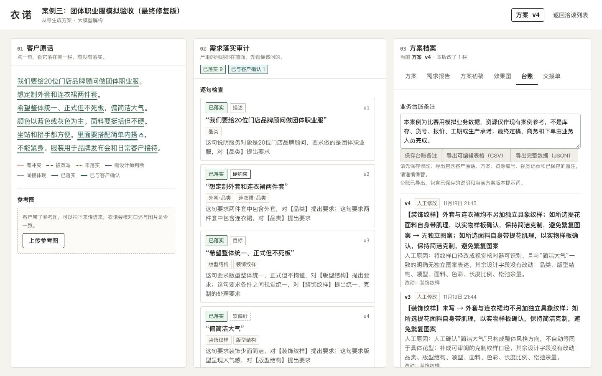

# 衣诺 · 海派定制服饰 AI 需求解构与可视化 Agent

衣诺面向上海服装集团海派高级定制与团体职业服场景，把客户感性口述整理为可追溯需求、案例资源匹配、方案初稿、视觉提示词和业务台账。系统输出始终是业务参考草稿，最终定稿、量体、报价、采购与生产由人完成。

> 公开版说明：本仓库不包含主办方提供的真实案例照片、留出测试案例原文及原始评测运行记录；相关测试与脚本在缺少这些素材时自动跳过。界面中的案例配图均为 AI 生成示意图。

## 当前交付

- 此前的临时外网测试入口已失效，当前演示使用本机环境（后端 8100、前端 5173），不依赖外部链接。
- 两套完整模拟案例：高端海派私定、20 人门店品牌顾问团体职业服。
- 43 项资源分类目录，其中 40 项有开发案例依据并可进入推荐。
- 官方六维加情绪审美、使用场景、使用人群的九维需求报告，支持原话校验、人工核对和修订留痕。
- 完整方案初稿、三类视觉提示词、CSV/JSON v2 台账和 Markdown 导出。
- 技术验收矩阵：[最终验收清单](docs/交付/最终验收清单.md)

本机演示依赖本机 Magpie 模型网关；视觉识别本次不作为可运行能力展示。它不是固定网址、高可用或经过生产安全审计的线上服务。



## 快速运行

```sh
python3 orchestration/start_backend.py --port 8100
python3 orchestration/start_vision.py --port 8001
cd frontend
npm run dev -- --host 127.0.0.1
```

浏览器打开 `http://127.0.0.1:5173`。真实模型请求经 `http://127.0.0.1:3425/v1` 的 Magpie 网关，默认模型为 `auto/deepseek-v4.1-flash`。视觉服务需要先在 iCloud 同步目录之外建依赖环境（见 `orchestration/start_vision.py` 顶部说明）和本机 Ollama 的 `qwen2.5vl:7b`、`qwen2.5vl:3b`；没启动时看图入口会直接说明，文字核对不受影响。

生产构建：

```sh
cd frontend
npm run build
```

本机测试网关（可选，仅用于本机验证，不对外提供入口）：

```sh
python3 orchestration/start_backend.py --port 8102 \
  --storage-dir orchestration/runs/external-test/final-storage-20261119
python3 orchestration/start_vision.py --port 8001
python3 orchestration/start_test_gateway.py
```

## 主要页面

- 首页：标题“客户说了什么？”，把客户原话贴进输入框；可选“＋ 附上已有方案（可选）”展开八栏输入，附了方案就核对已有方案，没附就从零生成；下方一排预置示例案例按钮（不含案例五），右侧是“最近的洽谈”列表。点“开始分析”后显示四步进度，右上角可进“资源知识库”。
- 工作台：顶部四步——①核对需求 ②和客户确认 ③方案 ④交接；完成的步骤打勾，“和客户确认”上显示还剩几个问题。左侧固定显示客户原话，点一句可看它对应方案哪一栏和判断理由，参考图上传也在左侧。①先给结论，再列需要处理的句子；②一次问一题，答完显示方案版本和栏位变化；③分“方案要点 / 完整初稿 / 效果图”三个视图；④以交接单为主，旁边切换修改记录。
- 资源知识库：按类型、风格、场景查看资源来源、使用规范、缺失字段并导出分类 CSV。

## 两套完整案例

- [案例二：高端海派私定](docs/交付/案例二_完整验收_20261119.json)
- [案例三：团体职业服](docs/交付/案例三_完整验收_20261119.json)

两套案例均包含完整会话、结构化需求、方案、资源适配、视觉需求包和台账。浏览器验收文件在 `docs/交付/验收证据/`。

## 测试

```sh
orchestration/.venv/bin/pytest -q backend/tests
orchestration/.venv/bin/pytest -q eval/test_formal_eval.py eval/test_metrics.py eval/test_holdout_once.py
orchestration/.venv/bin/pytest -q orchestration/test_test_gateway.py
(cd orchestration && .venv/bin/python -m unittest -q test_worker.py)
(cd frontend && npm run build)
```

当前结果：后端 330 passed、3 skipped；评测 56 passed；网关 1 passed；Magpie 工作区边界 8 passed；前端生产构建通过。3 个跳过项是实时视觉测试，不能据此宣称视觉全部通过。

## 关键文档

- [参赛方案与实现说明](docs/交付/参赛方案与实现说明.md)
- [最终验收清单](docs/交付/最终验收清单.md)
- [开发状态](docs/交付/开发状态.md)
- [能力边界清单](docs/交付/能力边界清单.md)
- [演示与交付手册](docs/交付/演示与交付手册.md)
- [外部测试环境说明](docs/交付/外部测试环境说明.md)
- [交付文件清单](docs/交付/交付文件清单.md)

## 明确边界

- 资源是历史案例参考，不是库存、货号、报价或当前可采购物料。
- 视觉模型曾把案例六交领识别成立领，必须人工复核；衣长、廓形和颜色不采用模型判断。
- D2/D3 是旧版评测；D2 未显示领先，D3 没有证明未见案例的问题检出泛化。
- 当前没有调用付费生图。
- 系统不输出具体尺寸、报价、制版、采购或下单指令。
