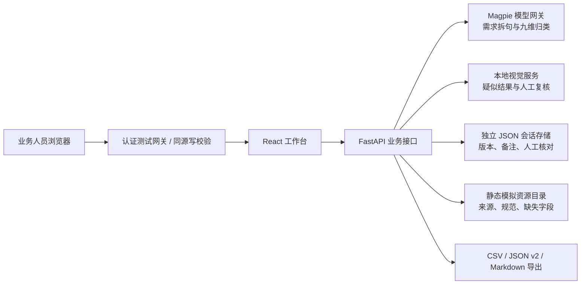

# 衣诺：海派定制服饰 AI 需求解构与可视化 Agent

## 1. 业务目标与核心方法

衣诺面向海派定制门店的首次洽谈和方案交接，解决三类具体问题：客户原话在整理中丢失，方案替换了要求却没人发现，以及多次口头修改后无法说明“为什么改成现在这样”。系统把客户口述整理为可核对的需求、带案例出处的方案初稿、效果图提示词和交接单，帮助业务员减少漏问、漏记和重复核对。所有 AI 判断均为初稿，最终设计、量体、报价、采购与生产决策由人完成。

核心方法是三项相互衔接的技术：

**第一，原话级需求溯源。** 系统保留客户原话片段及其在原文中的位置，再映射到八个设计字段和七种核对状态。模型输出后，程序校验引用是否确为客户原文，避免把总结性文字冒充客户原话。业务价值是：出现争议时，业务员能回到“客户到底说了什么”，而不是只看一份无法追溯的摘要。

**第二，软硬约束匹配。** 对“一定、不能、不要”等明确要求，先用于排除不符合的资源；对“最好、偏向”等偏好，用于候选排序。资源无法满足时，不擅自替换，而是形成客户问题或人工待办。业务价值是：既避免把偏好全部当成硬条件导致无方案可选，也防止为了出方案而牺牲客户的明确底线。

**第三，生成后校验。** 方案引用资源后，程序再次检查资源编号是否真实存在；找不到依据的字段明确标为“库中暂无 · 待找样”，并保留人工找样或核实事项。资源库除上服案例拆出的做法外，另附一份标明“模拟库”的常见做法和模拟仓库（演示数据），用来演示“方案 → 领料”的衔接；落地时整份替换为上服真实做法库和库存，流程不改。业务价值是：把“有案例参考”和“尚待人工确认”分开，减少错误出处进入设计交接的风险。

三项技术共同形成“原话可追溯、选择有规则、结果能复核”的闭环。它们不保证所有语义判断正确，因此业务员复核、客户确认和设计师判断是流程中的必要环节。

## 2. 业务流程

1. 录入客户口述；可选择审计已有方案或生成初稿。
2. 以原话片段展示需求、设计字段与状态；真实模型按九个维度生成可追溯分类，包括官方六维、情绪与审美、使用场景、使用人群。每项引用都校验为会话内原话，业务人员再完成人工核对、修正和说明保存。
3. 查询现有案例资产，按资源类型、风格和场景筛选，查看来源、适配规范与缺失元数据；缺失资源保留为人工待办。
4. 查看当前版本的方案初稿、关联原话、出处、客户待确认问题和设计师事项；确认与人工修改保留版本及台账。
5. 根据方案生成成衣挂拍、面料细节和上身效果三类提示词；多件套要求所有件同框。可上传参考图或外部图片进行辅助核对。
6. 保存业务台账备注，并导出 CSV 表格或包含完整会话、九维需求报告、方案初稿、资源适配和视觉提示词的 JSON 数据。导出前应先保存编辑内容。

两套完整案例：

- [案例二：高端海派私定完整验收](案例二_完整验收_20261119.json)，含 CSV、方案 Markdown 与浏览器证据。
- [案例三：团体职业服完整验收](案例三_完整验收_20261119.json)，含 20 人门店品牌顾问场景、v4 方案、九维人工核对、10 份业务说明、17 条台账和三类提示词。
- [定制资源分类清单](定制资源分类清单_20261119.csv)，当前共 43 项，其中 40 项有开发案例依据并可进入推荐。

## 3. 架构设计

- 前端：Vite、React、TypeScript。工作台式界面：左侧导航（新建洽谈、资源知识库、最近洽谈），每场洽谈为三栏——客户原话与参考图、当前步骤、方案速览；四步为核对需求 → 和客户确认 → 方案 → 交接。吉祥物“衣诺”用于等待、完成和空状态提示。本地生产构建可由 Vite preview 访问。
- 后端：FastAPI。通过兼容接口经 Magpie 调用 DeepSeek；程序规则负责匹配、冲突复核、版本及台账。
- 存储：本机 JSON 会话文件，需求与业务备注另存于会话对应的备注文件；更新采用会话锁与原子替换。此存储尚不是多机或多进程数据库。
- 数据：`data/` 中的静态模拟案例和整理出的资源；`/api/resource-catalog` 把可追溯标签、使用规范、缺失字段与推荐资格整理成只读分类目录。案例来源不等于库存、货号、供应商或当前可采购性。
- 视觉：本机视觉服务（FashionSigLIP + Qwen2.5-VL，本机推理）对图片作独立识别，再由规则与客户原话对照；视觉结果仅作人工复核线索。
- 生图：默认关闭付费生图，提供提示词和外部图片上传核对。

## 4. 验证结果与证据边界

**已完成的是业务闭环验证。** 案例二和案例三均使用真实模型完成端到端流程，覆盖需求核对、客户确认或人工修订、版本记录、方案初稿、提示词和交接导出。两套案例证明原型可以运行，不等同于统计意义上的效果验证。

**本轮对照评测没有显示优势。** D2 使用团队自造、与开发同源的问题注入集，衣诺检出 32/54，同一模型的通用问法为 33/54。样本量小，标准答案也未经设计师逐条独立确认，因此不能宣称衣诺检出率更高。D2 基于历史后端快照，也不能直接当作当前版本成绩。

**留出问题检出仍未得到验证。** D3 在冻结后只运行一次案例五，状态完全一致为 5/8；该案例没有标准问题句，问题检出为 0/0，无法评价问题检出的泛化能力。案例五已按约束只运行一次并保留原始记录，今后不用于开发、调参或演示。

**可追溯性检查有明确范围。** D2 的 75 次成功输出均通过“原话可定位、资源编号存在”两类自动检查，但这不证明解释文字、专业判断或现实资源信息全部正确。

**视觉识别有已知误差。** 冻结的视觉模型把案例六交领外套识别成立领；领型、闭合、纽扣与花纹最高为疑似，衣长、廓形和颜色由人确认。

下一阶段最有价值的验证，不是继续展示开发案例，而是由业务员和设计师使用独立新案例，分别评估漏判、误报、修改成本、交接可读性和实际耗时。

## 5. 落地路径

先用授权的模拟案例和业务人员开展封闭试用，收集误报、漏报、无出处、台账可读性和耗时问题；由设计师审核资源分类与适配规则，再在明确数据权限与安全条件后规划企业系统对接。当前原型不对接生产系统或定制业务真实 API。

## 6. 风险与合规

- 客户原话和导出文件可能包含个人信息：测试使用模拟数据，控制访问与留存，不向未经授权的人分享。
- 模型可能漏掉、误解或编造；不能把原话定位与资源编号校验通过称为“零幻觉”。
- 方案、尺寸和工艺需专业人员复核；资源只是案例参考，不作库存承诺。
- 视觉误识别和未识别项应保留、标明疑似，禁止将效果图当作成衣质量保证。
- 付费模型与生图应依据明确的预算和授权配置，不将本地网关直接无保护暴露到互联网。

## 7. Agent 能力边界清单

独立清单见 [能力边界清单](能力边界清单.md)。本方案不宣称检出率领先、留出问题检出已泛化、视觉全部通过或已对外上线。

## 8. 当前交付状态与已知缺口

本次交付包含可演示原型、案例二与案例三两套现成完整模拟案例、资源目录、方案初稿、三类效果图提示词、CSV/JSON 台账，以及架构、风险、能力边界和[对照命题要求的逐条方案说明](对照命题要求的逐条方案说明.md)。演示以本机真实模式和预置案例为主，不依赖已失效的外部测试链接。

截至 2026 年 11 月 24 日，真实生图保持关闭，只交付提示词和外部图片核对流程。视觉服务已在本机恢复：参考图上传后首次约 1 分钟、预热后约十几秒返回，能现场演示图与话的冲突；案例六交领误识别为立领的已知误差仍保留。对外展示的资源来源不再列出留出案例五。3 分钟 Demo 视频按赛道要求以公开直链随最终提交提供。

当前仍是单机原型：真实模式一次分析需要等待模型返回，本地示例模式只用于预置案例的界面演示，不能作为模型效果证据。正式试点前仍需恢复视觉环境、使用独立新数据评测当前版本，并完成多用户隔离、备份、监控和故障恢复验证。
